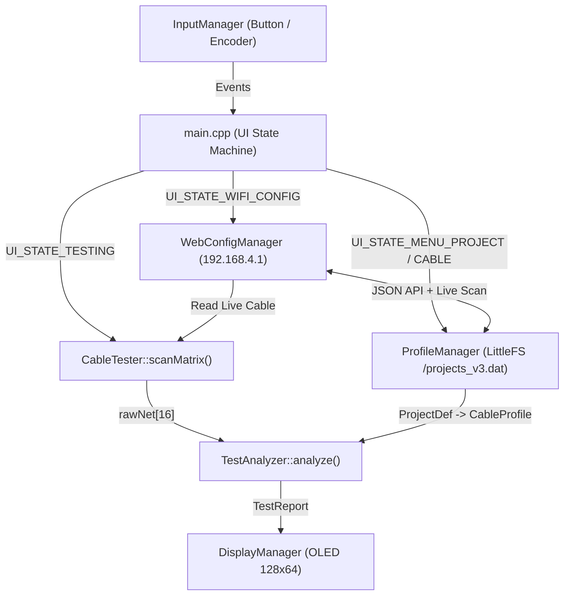

# 2. Архітектура прошивки та алгоритми

## 2.1. Модульна структура проєкту (v3.0)

```text
CableChecker/
├── platformio.ini              # Конфігурація збірки, прапорці -Wall -Wextra, залежності
├── include/
│   ├── config.h                # Піни, адреси I2C, ліміти бази проєктів, параметри Wi-Fi AP
│   ├── TestResults.h           # Структури звіту TestReport, PinStatus, TestVerdict, HardwareFault
│   ├── CableProfiles.h         # Ієрархічна модель Проєкт -> Кабель (LittleFS + CRC32)
│   ├── CableTester.h           # Драйвер MCP23017 та алгоритм псевдо-Open-Drain сканування
│   ├── TestAnalyzer.h          # Аналізатор топології (1:1, крос, 1-на-N розгалуження, перемички)
│   ├── InputManager.h          # Неблокуючий FSM кнопки / енкодера та звукового зумера
│   ├── DisplayManager.h        # Дерево екранів (Testing, Project Menu, Cable Menu, Wi-Fi AP)
│   └── WebConfigManager.h      # Вбудований HTTP-сервер та SPA-конфігуратор (192.168.4.1)
└── src/
    ├── main.cpp                # Координатор FSM екранів, сканера та Web-сервера
    ├── CableProfiles.cpp
    ├── CableTester.cpp
    ├── TestAnalyzer.cpp
    ├── InputManager.cpp
    ├── DisplayManager.cpp
    └── WebConfigManager.cpp
```

---

## 2.2. Схема потоків даних та станів (`v3.0`)



---

## 2.3. Організація зберігання проєктів і кабелів (`ProfileManager` + `LittleFS`)

Замість фіксованого списку профілів реалізовано двоступеневу ієрархію **Проєкт (`ProjectDef`) → Кабель (`CableProfile`)**:

- **Кількість проєктів:** до `8` (`MAX_PROJECTS`).
- **Кількість кабелів у кожному проєкті:** до `8` (`MAX_CABLES_PER_PROJECT`), загалом до **64 унікальних конфігурацій кабелів**.
- **Параметри кожного кабелю (`CableProfile`):**
  - `name[16]` — назва кабелю.
  - `pinsA` (`1..8`) та `pinsB` (`1..8`) — реальна кількість контактів на роз'ємі А та роз'ємі Б (дозволяє перевіряти асиметричні перехідні кабелі, наприклад `4P -> 6P`).
  - `isProbeMode` — прапорець вільного продзвонювання.
  - `expectedNet[16]` — повна 16×16 бітова матриця очікуваних з'єднань.

### Підтримка складних джгутів (Транзитивне замикання за алгоритмом Уоршелла)
У кастомних кабелях один контакт (наприклад, спільний `GND` на `A1`) може розгалужуватися на декілька контактів сторони Б (`B1` та `B4`), або мати локальну перемичку (`B5 - B6`). Фізично всі з'єднані в один вузол контакти під час сканування утворюють повний підграф (кліку).
Функція `ProfileManager::normalizeNetTransitive()` автоматично виконує транзитивне замикання матриці при створенні або редагуванні кабелю:
- Якщо користувач задав `A1 ↔ B1` та `A1 ↔ B4`, система автоматично додає очікуваний зв'язок `B1 ↔ B4`.
- Завдяки цьому `TestAnalyzer` розпізнає розгалуження `1-на-N` та штатні перемички як **`PIN_STATUS_OK` (`|`, символ `+` або `J` у рядку B)**, але миттєво виявляє обрив будь-якої окремої гілки (`OPEN: A1 - B4`) або зайве замикання (`SHORT`).

### Надійність зберігання у `LittleFS`
Уся база проєктів зберігається у бінарному файлі `/projects_v3.dat` (`StorageImage`) разом із контрольною сумою **`CRC32`**.
- Читання або запис займає менше 3 мс і не викликає фрагментації оперативної пам'яті.
- При першому старті (або пошкодженні файлу) автоматично розгортається стартовий набір із 3 проєктів:
  1. **`Standard IT`** (`RJ45 8P 1:1`, `RJ45 Cross`, `ETH 4P 1236`, `RJ11 6P4C`, `USB 4-Pin`).
  2. **`Project A`** (`Power 4P [4->4]`, `Sens 4->6P [4->6]`, `Split GND 4P [4->4]`).
  3. **`Lab & Slots`** (`Live Probe`, `Saved Slot 1..3`).

---

## 2.4. Вбудований Wi-Fi Web-конфігуратор (`WebConfigManager`)

- **Енергоощадний режим за замовчуванням:** У режимі тестування радіомодуль ESP8266 примусово вимкнений (`WiFi.mode(WIFI_OFF); WiFi.forceSleepBegin();`), тому не створює затримок і не споживає зайвий струм.
- **Запуск за вимогою:** Обирається в меню проєктів (`[Wi-Fi Web Setup]`). Створює точку доступу **`CableChecker-Setup`** з IP-адресою **`192.168.4.1`**.
- **Можливості Web-додатка (SPA в `PROGMEM`):**
  - Створення, перейменування та видалення проєктів і кабелів.
  - Вибір кількості контактів `pinsA (1..8)` та `pinsB (1..8)`.
  - Візуальна матриця `A1..A8 ↔ B1..B8` та конструктор довільних пар (включно з перемичками `A-A` / `B-B` та розгалуженнями `1-на-N`).
  - Кнопка **«Зчитати з кабелю в тестері» (`GET /api/live`)** — опитує фізичний кабель у портах `RJ3.1`/`RJ3.2` і переносить його схему розпайки безпосередньо в редактор браузера.
  - **Експорт та Імпорт JSON** — збереження резервної копії всіх проєктів у файл `cablechecker_projects.json` на телефоні або ПК.
